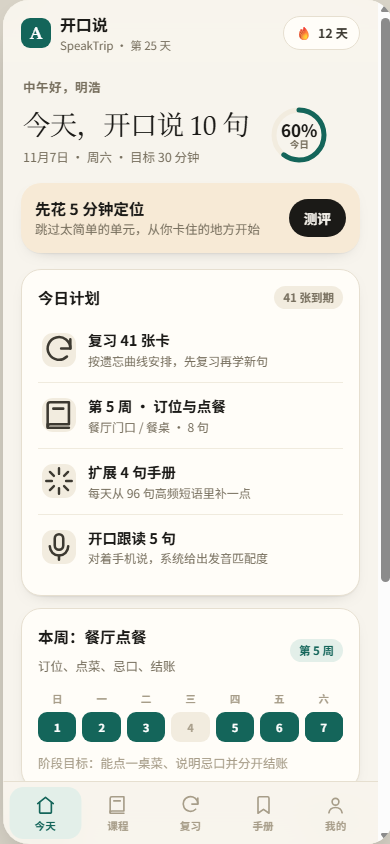
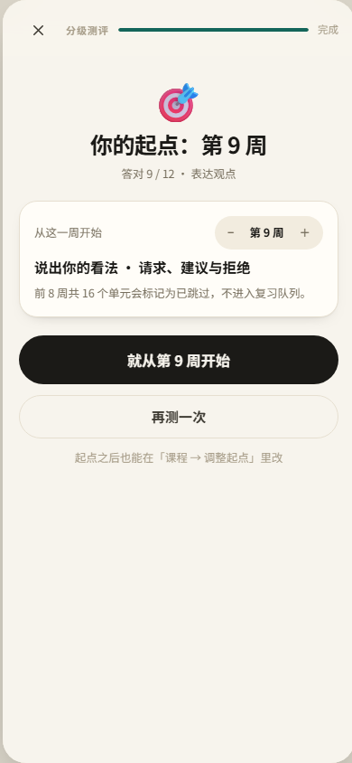
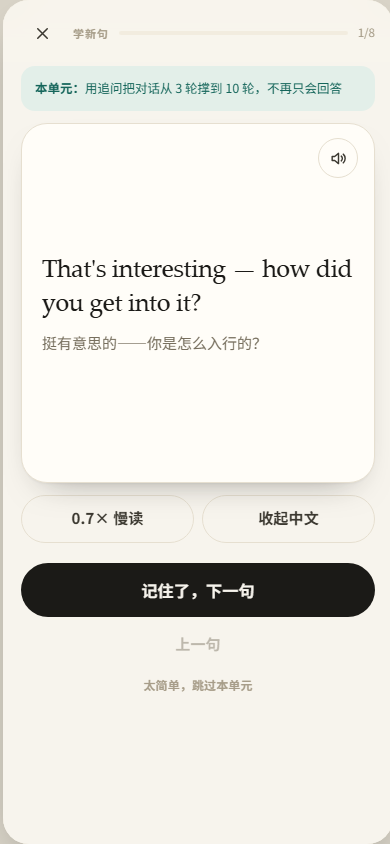

# 开口说 · SpeakTrip

一个**可以直接装到手机上**的出国英语口语训练应用。纯静态网页（PWA），无需后端、无需账号，装到主屏后像 App 一样打开，**断网也能学**。

- **16 周 · 32 个真实场景 · 256 句高频表达 + 96 句口袋手册**
- 主线 W1–12（生存 → 日常），进阶 W13–16（B1–B2：追问、叙事、反驳、协商、租房、就医、面试、群聊）
- 每单元：**学 8 句 → 听力 5 题 → 跟读 5 句 → 8 轮情景角色扮演**
- **分级测评**：12 道听力题定起点，太简单的单元自动跳过；学习卡可一键「太简单」
- 跟读打分：浏览器语音识别 + 词级对比，红色标出没念到的词
- 复习：SM-2 间隔重复，到期才出现
- **课程包自动更新**：打开时静默检查新内容并合并，断网继续用缓存
- **AI 加练**：填自己的 API Key，按你的水平现写 6 句
- 数据只存本机，支持导出 / 导入 JSON 备份





---

## 1. 30 秒在本机跑起来

在这个文件夹里打开终端：

```powershell
python -m http.server 8080
```

浏览器打开 <http://localhost:8080>（语音识别需要 localhost 或 https，localhost 是允许的）。

也可以直接双击 `start-server.bat`（Windows）。直接双击 `index.html` 也能学，但**跟读打分不可用**，且无法安装成 PWA。

---

## 2. 部署到手机（重点）

跟读评分需要 **HTTPS**，推荐用免费静态托管，把整个 `english-app` 文件夹传上去即可。

### 方式 A：Netlify Drop（最快，1 分钟）

1. 打开 <https://app.netlify.com/drop>
2. 把 `english-app` 文件夹直接拖进网页
3. 得到 `https://xxx.netlify.app`，手机浏览器打开
4. 按下一节「装到主屏」

### 方式 B：GitHub Pages（免费、稳定）

1. 新建仓库，把 `english-app` 里的文件推到仓库根目录
2. 仓库 **Settings → Pages → Source: Deploy from a branch → main / (root)**
3. 等 1 分钟，访问 `https://<用户名>.github.io/<仓库名>/`

### 方式 C：Vercel

```bash
npm i -g vercel
cd english-app
vercel
```

### 方式 D：只在局域网临时看（不能跟读评分）

```powershell
python -m http.server 8080
ipconfig    # 找 IPv4，例如 192.168.1.23
```

手机连同一 Wi-Fi，访问 `http://192.168.1.23:8080`。能学能听，但浏览器不在 HTTPS 下不允许调用麦克风识别。

---

## 3. 装到手机主屏

**iPhone（必须用 Safari）**
1. 打开网址
2. 底部「分享」→ 向下找 **「添加到主屏幕」**
3. 命名「开口说」→ 添加

**Android（Chrome / Edge）**
1. 打开网址
2. 右上角菜单 → **「安装应用」** 或「添加到主屏幕」

装好后是全屏、无地址栏的独立窗口，首次打开后离线可用。

---

## 4. 先做分级，别从 "Hi, I'm…" 开始

第一次打开会让你填名字、自评水平和每天时间。**只要不是「几乎零基础」，下一步就会进入 5 分钟分级测评**：12 句听力，答完给出起点周。

| 答对 | 建议起点 | 跳过的内容 |
|---|---|---|
| 0–2 | 第 1 周 | 无 |
| 3–5 | 第 3 周 | W1–2（打招呼、问路、机场基础） |
| 6–8 | 第 5 周 | W1–4（生存英语） |
| 9–10 | 第 9 周 | W1–8（日常场景） |
| 11–12 | 第 13 周 | W1–12（直接进 B1–B2） |

- 结果页可以 **− / ＋** 手动微调，再确认。
- 跳过的单元会标成「已跳过」，**不进入复习队列**；想补随时点开。
- 学某一课时觉得太简单，点学习卡底部的 **「太简单，跳过本单元」**：8 句直接记为已掌握，45 天后进复习，然后自动进下一课。
- 之后想改：**课程页顶部「调整起点」**，或 **我的 → 分级与起点 → 重新测评**。

> 已经有四级/六级基础但开不了口的人，测评通常落在 W5–W9：语法你都会，缺的是把句子说顺。直接从那里开始，省下的时间用来做输出。

---

## 5. 16 周怎么用

### 第 1–5 周：走完 32 个单元

每天 **1 个单元 + 复习**，约 30–40 分钟：

| 步骤 | 时间 | 做什么 |
|---|---|---|
| 复习 | 8 分钟 | 只看英文，先在心里说中文，再翻面评分 |
| 新课 | 15 分钟 | 学 8 句 → 听力 5 题 → 跟读 5 句 |
| 对话 | 8 分钟 | 先听整段，再角色扮演（你演 B） |
| 扩展 | 5 分钟 | 「复习」里的 4 句手册新句 |

32 天约 5 周。做了分级测评跳过前面的话，会更快。

### 第 6–9 周：变熟

- 每天清空到期复习（15–25 分钟）
- 每天跟读 5 句，重点练**句子节奏**，不是单词
- 每周挑 4 段对话，**不看提示**重演
- 通勤时听「手册 → 收藏」里的句子

### 第 10–16 周：真实输出（最关键）

- 每周至少 **2 次真人对话**，每次 20 分钟：HelloTalk、Tandem、青旅公共区、咖啡店搭话
- 对话后 10 分钟内，把**当时说不出来的 3 句话**记下来 → 手册收藏相近句子 → 第二天重点跟读
- 每周录一段 1 分钟自言自语（今天做了什么 / 最想不通的一件事），回听，只改一个毛病
- 这个阶段应用只负责「复习 + 查漏 + 角色扮演热身」，主战场是真人

### 每天只有 20 分钟

**复习到期卡（8 分钟）+ 学半个单元（8 分钟）+ 跟读 3 句（4 分钟）**。宁可每天 20 分钟，也不要周末补 3 小时。

---

## 6. 课程包自动更新

应用把课程分成两层：

1. **内置课程**：`data/curriculum-1..5.js`，随应用一起发布，离线必带。
2. **课程包**：`content/manifest.json`，可在**不重新部署应用**的情况下更新。

启动时（以及每隔 6 小时）会静默拉一次 manifest：

- 远端 `version` 比本地新 → 合并新单元 / 新手册分类，写入 `localStorage`，下次启动直接可用
- 断网、404、格式错误 → 静默失败，继续用缓存，**不影响任何学习功能**
- 也可以在 **我的 → 内容更新 → 检查更新** 手动触发

### manifest 格式

```json
{
  "version": 2,
  "updatedAt": "2026-12-01",
  "weeks": [{ "n": 17, "title": "谈判", "focus": "让步与条件", "milestone": "能谈成一个折扣" }],
  "units": [
    {
      "id": "w17u1",
      "week": 17,
      "tier": "adv",
      "title": "谈价格",
      "scene": "市集 / 房东",
      "goal": "把价格谈下来 10%",
      "tip": "先问不买：Is that your best price?",
      "chunks": [["Is that your best price?", "这是最低价吗？"]],
      "dialogue": { "user": "B", "lines": [["A", "It's fifty.", "五十。"], ["B", "Would you take forty?", "四十行吗？"]] }
    }
  ],
  "phrases": [
    { "id": "bargain", "name": "砍价", "icon": "💰", "items": [["That's a bit steep.", "有点贵。"]] }
  ]
}
```

### 发布新内容

1. 复制 `content/manifest.json`，改 `version`（必须比当前大）和 `updatedAt`
2. 把新单元写进 `units`（`id` 不能和已有重复），新手册写进 `phrases`
3. 部署到任意 HTTPS 地址：可以就在本站 `content/manifest.json`，也可以是 GitHub Raw、对象存储、自己的服务器
4. 如果不是本站，把地址填到 **我的 → 内容更新 → 内容地址 → 保存地址**
5. 用户下次打开应用自动更新；急的话点「检查更新」

> 合并只做加法：不会删除内置单元，不会覆盖用户进度。`version` 不递增则不会重复合并。

---

## 7. AI 加练（可选）

**我的 → AI 加练**，或首页「随手用 → AI 加练」。

1. 填接口地址、模型、API Key（默认 DeepSeek：`https://api.deepseek.com` / `deepseek-chat`）
2. 选话题（旅行 / 工作 / 点餐 / 闲聊 / 观点 / 抱怨）和难度（B1 / B2 / C1）
3. 生成 6 句，逐句朗读、跟读打分，不满意就「换一批」

注意：

- Key **只存在本机 localStorage**，只会发给你填的那个接口，应用本身没有后端。
- 浏览器直连可能被服务商的 **CORS** 拦住。DeepSeek / OpenAI 通常可用；不行就换支持浏览器调用的服务，或用 Ollama 本地跑。
- AI 生成的句子**不进入间隔重复队列**，它是「加练」，主线才是骨架。
- 生成质量会有波动，看到别扭的句子直接跳过，别背。

---

## 8. 数据与隐私

- 学习记录存在浏览器 `localStorage`，不上传任何服务器。
- **换手机 / 清缓存会丢进度**：定期在「我的 → 导出」保存 JSON，新设备「导入」恢复。
- 语音识别由浏览器调用（Chrome 走 Google 服务，Edge 走微软服务）；应用本身不保存录音。
- AI 的 Key 只在本机，导出备份时**会包含 Key**，分享备份前请删掉。

---

## 9. 已知限制

| 限制 | 说明 |
|---|---|
| 跟读评分需要 HTTPS | 局域网 IP 或 `file://` 下不可用，界面自动降级为「看提示跟读」 |
| iOS Safari 语音识别支持有限 | 可能提示不可用；用 Chrome/Edge 体验最好，或装到主屏后重试 |
| 发音人取决于系统 | 「我的 → 发音人」可切换；没有高质量英文语音时装系统语音包 |
| 离线更新 | 内容更新需联网一次；改了 `js/` 或 `css/` 要把 `sw.js` 的 `CACHE` 版本号 +1 |
| AI 依赖第三方接口 | CORS、额度、模型名都可能变；失败不影响主线 |
| 不做账号同步 | 有意为之：零注册、零后端 |

---

## 10. 文件结构

```
english-app/
├── index.html              应用入口（无构建）
├── manifest.webmanifest    PWA 清单
├── sw.js                   Service Worker（离线缓存 + 课程包网络优先）
├── css/app.css             全部样式（跟随系统深浅色）
├── js/
│   ├── core.js             纯逻辑：SRS、评分、计划、分级、统计（可在 Node 测）
│   ├── speech.js           TTS / ASR / 反馈音
│   ├── content.js          课程包同步（manifest → 合并 → 缓存）
│   ├── ui.js               外壳、路由、今天/课程/手册/我的/引导
│   ├── learn.js            单元课、复习、跟读训练
│   ├── level.js            12 题分级测评
│   ├── ai.js               AI 加练（OpenAI 兼容接口）
│   └── selftest.js         页面内自检（?selftest=1）
├── data/
│   ├── curriculum-1..4.js  W1–12 主线（24 单元）
│   ├── curriculum-5.js     W13–16 进阶（8 单元，B1–B2）
│   └── phrasebook.js       8 场景 × 12 句手册
├── content/manifest.json   课程包清单（可远端替换）
├── icons/                  PWA 图标
├── tools/make_icons.py     重新生成图标
├── tests/                  自检脚本、测试课程包、预览壳
└── start-server.bat        一键本地预览
```

---

## 11. 自检

```bash
node tests/node-check.cjs          # 内容完整性 + SRS + 分级/跳级（34 项）
```

浏览器打开 `http://localhost:8080/index.html?selftest=1` → **65 项** UI/流程自检（完整走完一课、复习、分级确认、路由、课程包合并）。

390×844 预览壳：`http://localhost:8080/tests/frame.html#/today`

---

## 12. 设计取舍

- **句子优先，不背单词表**：出国需要的是「整块能说出口的话」。
- **先听再读最后说**：输入 → 辨认 → 输出 → 情景，四步走。
- **复习只认真实感受**：宁可点「困难」，也不要蒙对点「记得」。
- **起点比进度重要**：与其从第一课刷起，不如先测一下，把时间花在真正卡住的地方。
- **内容可以长出来**：主线打包在应用里保证离线，新内容走课程包，不用每次重新发版。
- **不做社交、不做排行榜**：安静、可离线、不焦虑。
